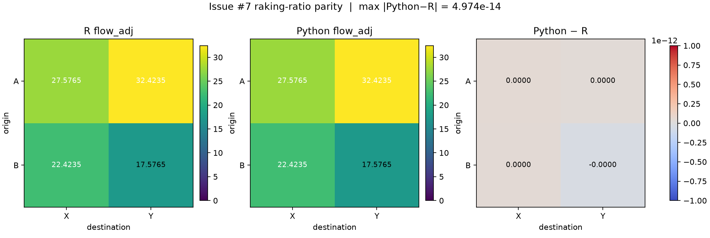

# Issue #7: R/Python raking-ratio parity

## Reproduction

```bash
DEBIASR_ROOT=/path/to/debiasR uv run python scripts/verify_raking_ratio_r_parity.py
```

## Environment

- Python: 3.12.15 (macOS-15.6.1-arm64-arm-64bit)
- debiaspy: 0.0.0
- R: Rscript (R) version 4.6.1 (2026-06-24)
- DEBIASR_ROOT: `$DEBIASR_ROOT`
- debiasR revision: `6fa2709ae42de6dc525a4a46182fdfb448b14a3f`
- R source: `$DEBIASR_ROOT/R/adjust_raking_ratio.R`

## Fixture

Deterministic 2×2 OD table:

| origin | destination | flow |
| --- | --- | ---: |
| A | X | 10 |
| A | Y | 20 |
| B | X | 30 |
| B | Y | 40 |

Origin targets: A=60, B=40. Destination targets: X=50, Y=50.
Controls: `max_iter=200`, `tol=1e-10`, default clipping.
Cells are compared by `origin`/`destination` keys, not row order.

## Metrics

- Number of cells (Python / R): 4 / 4
- Max absolute difference (Python − R): 4.973799e-14
- RMSE: 4.300105e-14
- Max relative difference (|diff| / max(|R|, 1e-12); both-zero → 0): 2.223414e-15
- Max |origin margin Python − R|: 8.526513e-14
- Max |destination margin Python − R|: 9.947598e-14
- Max |origin margin Python − target|: 1.115552e-12
- Max |destination margin Python − target|: 0.000000e+00
- IPF converged (Python / R): True / True
- IPF iterations (Python / R): 7 / 7

### Adjusted matrices

R `flow_adj`:

| origin | X | Y |
| --- | --- | --- |
| A | 27.57650672 | 32.42349328 |
| B | 22.42349328 | 17.57650672 |

Python `flow_adj`:

| origin | X | Y |
| --- | --- | --- |
| A | 27.57650672 | 32.42349328 |
| B | 22.42349328 | 17.57650672 |

## Figure



## Conclusion

Python and R agree on this unclipped 2×2 fixture to numerical tolerance: cell-wise differences are negligible, origin and destination margins match the shared targets, and both runs report IPF convergence.

Deliberate Python differences outside this unclipped fixture remain: clipped weights are recomputed into `flow_adj`, clipping marks non-convergence, and invalid inputs raise explicit errors.
