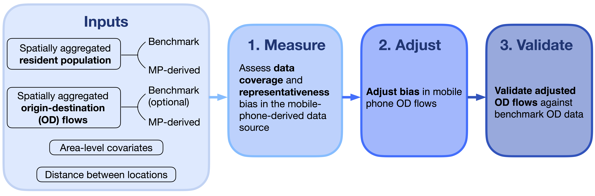

## Overview

{fig-alt="DEBIAS hex logo" width="220"}

`debiaspy` is a Python package for assessing and correcting population
representation bias in digital trace data. It is part of the
[DEBIAS project](https://de-bias.github.io/debias/) and the wider
[DEBIAS GitHub organisation](https://github.com/de-bias).

The package is designed for spatio-temporally aggregated data that provide
population counts by location and flows between locations. The workflow supports
assessment of coverage and representativeness bias in population counts,
adjustment of biased origin-destination (OD) flows and validation of adjusted
flows against benchmark data.

Mobile-phone-derived mobility data will be used to illustrate the package
functions in the tutorials, but the same logic can apply to other digital trace
sources with comparable spatial and temporal aggregation and a validation
target. Examples include trade of goods, Internet traffic, supply chains and
other location-to-location flows.

`debiaspy` is being developed alongside the R package
[`debiasR`](https://github.com/de-bias/debiasR), but the Python package is
documented and organised as a standalone tool for Python users.

## Installation

The package is not yet released on PyPI. For local development, clone the
repository and install it in editable mode:

```bash
git clone https://github.com/de-bias/debiaspy.git
cd debiaspy
python -m venv .venv
source .venv/bin/activate
python -m pip install -e ".[dev]"
```

Check that the package imports:

```bash
python -c "import debiaspy; print(debiaspy.__version__)"
```

Install the empirical data companion when you need to reproduce tutorials or
examples that use the packaged mobility, Census, covariate and coverage data:

```bash
python -m pip install git+https://github.com/de-bias/debiaspydata.git
```

If `debiaspy` and `debiaspydata` are cloned side by side under the same parent
folder, install the local data package in editable mode with:

```bash
python -m pip install -e ../debiaspydata
```

## Usage

The first implemented group of functions measures area-level coverage bias,
compares the spatial distributions of active users and the population and
examines residual structure:

```python
import pandas as pd
from debiaspy import (
    measure_bias,
    measure_bias_distribution,
    validate_bias_residual_structure,
)

coverage = pd.DataFrame(
    {
        "area": ["A", "B"],
        "population": [1000, 800],
        "user_count": [100, 40],
    }
)

area_bias = measure_bias(coverage)
distribution_bias = measure_bias_distribution(coverage, area_col="area")
residual_bias = validate_bias_residual_structure(
    coverage,
    coverage_area_col="area",
)
```

`measure_bias()` returns the input data with three added columns:

- `coverage_score`: `user_count / population`
- `coverage_bias`: `1 - coverage_score`
- `bias`: an alias of `coverage_bias`

`measure_bias_distribution()` and `validate_bias_residual_structure()` return
dictionaries of pandas DataFrames. These separate the overall summaries from
the area-level values and any optional diagnostics.

## Framework

The package follows a three-stage workflow:

1. measure population coverage and representativeness bias
2. adjust biased origin-destination flows
3. validate adjusted flows against benchmark data

{fig-alt="Three-stage DEBIAS origin-destination workflow"}

## Tutorials

- [Why this matters](docs/tutorials/t02-why-this-matters.qmd)
- [Getting started](docs/tutorials/t03-getting-set-up.qmd)
- [Measuring population coverage bias](docs/tutorials/t04-measuring-coverage-bias.qmd)
- [Explaining population coverage bias](docs/tutorials/t05-identifying-and-explaining-bias.qmd)
- [Adjusting biases in origin-destination flows](docs/tutorials/t06-adjusting-biases.qmd)
- [Validation](docs/tutorials/t07-validation.qmd)
- [Visualising origin-destination flows](docs/tutorials/t08-visualising-flows.qmd)
- [Advanced Bayesian multilevel adjustment](docs/tutorials/t09-advanced-bayesian-adjustment.qmd)

## Development

See the [development workflow](docs/development/workflow.md) for local setup,
testing and contribution checks.

## Repository structure

- `src/debiaspy/` - package modules and placeholder Python counterparts to the
  current `debiasR/R` files
- `tests/` - `pytest` tests
- `docs/tutorials/` - package-facing Quarto tutorials
- `docs/development/` - local development workflow notes
- `.github/` - issue and pull request templates
- `CONTRIBUTING.md` - contribution guidance
- `pyproject.toml` - Python package metadata, build configuration and
  development dependencies
- `LICENSE` and `LICENSE.md` - licensing information
- `README.md` - package overview and development instructions

## License

This repository uses an MIT software licence:

- **MIT License** for software code

The licensing approach for future documentation, data and non-code content can
be expanded as those materials are added.

## Core development team

The core development team consists of **Carmen Cabrera** and **Francisco Rowe**
(University of Liverpool).

We actively maintain and develop the DEBIAS package family and welcome
contributions from the wider research community, including new methods, bug
reports, feature requests, documentation improvements and ideas for future
development.

::: {.grid}
::: {.g-col-12 .g-col-md-6}
{fig-alt="Carmen Cabrera" width="120"}

**Carmen Cabrera**<br>
[Website](https://c-cabrera.com/) · [GitHub](https://github.com/carmen-cabrera)

Contributions: documentation, code, bug reports, content, design, examples,
ideas, infrastructure, maintenance, packaging, project management, research,
review, tools and tests.
:::

::: {.g-col-12 .g-col-md-6}
{fig-alt="Francisco Rowe" width="120"}

**Francisco Rowe**<br>
[Website](http://franciscorowe.com) · [GitHub](https://github.com/fcorowe)

Contributions: documentation, code, bug reports, content, design, examples,
ideas, infrastructure, maintenance, packaging, project management, research,
review, tools and tests.
:::
:::

## Contributing

We welcome contributions of all kinds: code, documentation, issues, examples
and methodological ideas. All changes to `main` should be made through pull
requests.

Please read [CONTRIBUTING.md](CONTRIBUTING.md) for the current workflow, local
setup, branch guidance and pull request expectations.
